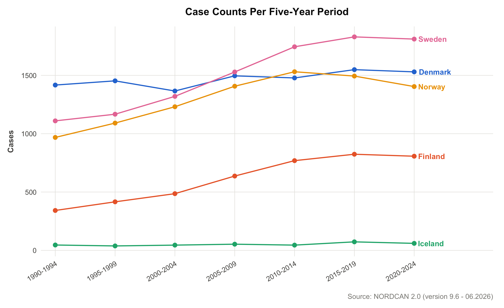
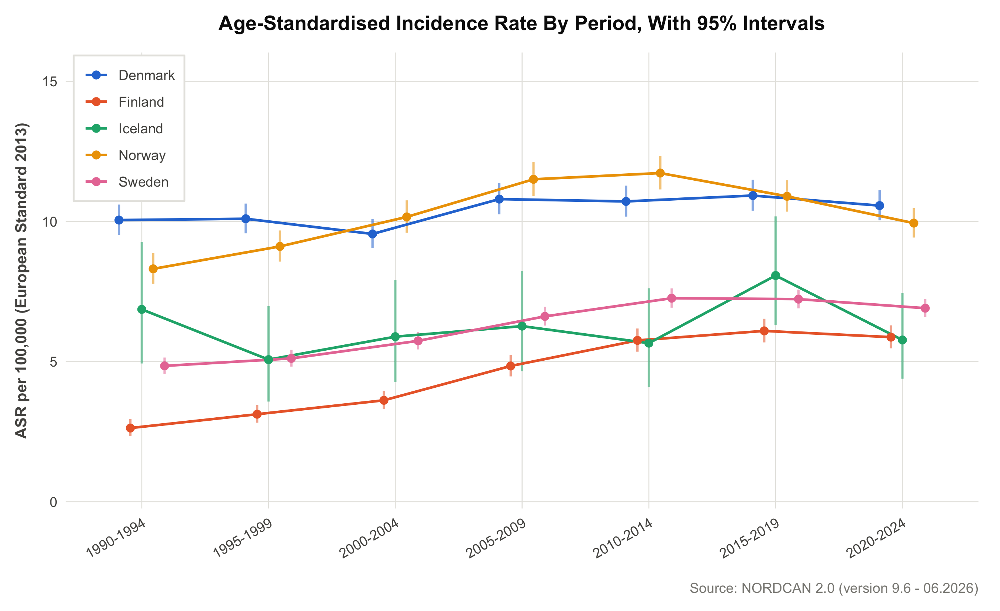
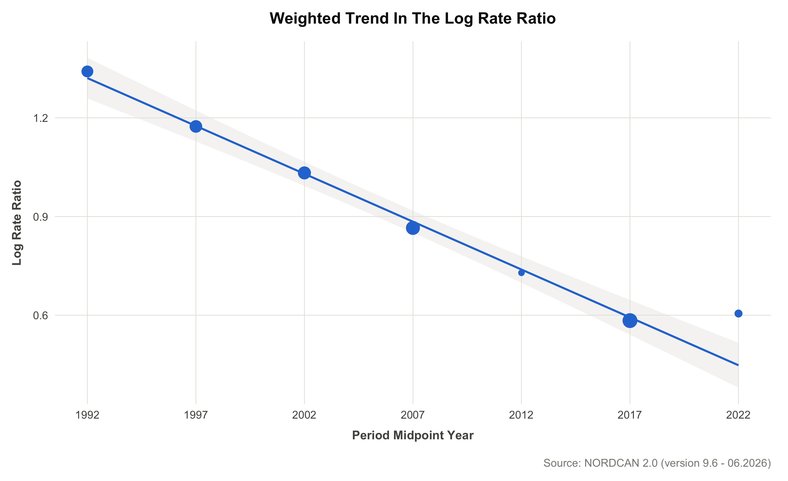

# The Nordic Testicular Cancer Gap Has More Than Halved

*Age-standardized incidence across five countries, 1990 to 2024*


## 📌 Executive Summary
This project measures how far apart five Nordic countries (Denmark, Finland, Iceland, Norway and Sweden) are in testicular cancer incidence, and whether that gap narrowed between 1990 and 2024. It uses public registry data from NORDCAN 2.0, one age-standardized rate for every country and five-year period, and a highest-to-lowest rate ratio for each period. It quantifies the gap and does not explain it. The full story is in the [slide deck (PDF)](nordcan-testicular-cancer-deck.pdf).

* **Scale:** **34,568 cases** of testicular cancer across **5 countries** and **7 five-year periods**, analyzed as 630 age-specific rows.
* **Core Finding:** The highest country's rate went from **3.82 times** the lowest country's rate in 1990-94 (Denmark against Finland) to **1.83 times** in 2020-24 (Denmark against Iceland), a **52% fall**. The narrowest point was **1.79** in 2015-19.
* **Trend:** A weighted regression puts the average change in the ratio at **-2.9% a year** (95% interval -3.2% to -2.5%).
* **Reliability:** The 95% intervals of the first and last ratios do not overlap (3.37 to 4.34 against 1.40 to 2.40), so the narrowing is larger than the uncertainty around it.
* **Validation:** The largest difference between the computed rates and NORDCAN's own published rates is **0.00015**, against a tolerance of 0.05 that was set before any computation ran.

---

## 🏢 Business Understanding & Problem Statement
A published survival study of male cancers in the Nordic countries (Tichanek et al., 2023) notes in its Discussion that national differences in testicular cancer incidence are not well understood, and that Danish rates are known to be some of the highest in the world. That study measured survival in four countries, without Iceland, and did not investigate the incidence gap.

**The Goal:** Put a number on the gap between the highest and the lowest country, and test whether that number is falling.

**The Challenge:** Countries differ in size and in age structure, so raw rates are not comparable. Testicular cancer is rare, so counts are small, especially in Iceland, and the uncertainty that comes with small counts has to stay visible.

**The Research Question:** How does age-standardized testicular cancer incidence compare across the five core Nordic countries, and has the gap between the highest and lowest country narrowed or persisted over 1990 to 2024?

**What Counts As An Answer:**
1. One comparable rate for every country and period.
2. A highest-to-lowest ratio for each period, with its interval.
3. A formal test of whether the ratio is falling.

---

## 📊 Data Understanding
* **Source:** NORDCAN 2.0, data version 9.6 (06.2026). Males, cancer of the testis, five core Nordic countries (Faroe Islands and Greenland excluded).
* **Periods:** 1990 to 2024 in seven consecutive five-year windows. Annual counts are too small for a rare cancer to give stable rates.
* **Iceland Is The Least Precise:** It contributes 38 to 73 cases per period, against 342 to 1,830 for each of the other four countries.

| Country | Total Cases | Age-Band Cells With No Cases |
|---|---|---|
| Denmark | 10,289 | 9 |
| Finland | 4,281 | 7 |
| Iceland | 360 | 48 |
| Norway | 9,126 | 8 |
| Sweden | 10,512 | 2 |
| **All Five** | **34,568** | **74 of 630** |

The populations also differ in age and have aged at different speeds. Finland's share of person-years at age 65 and over doubled, from 10.1% to 20.6%, which is why raw rates cannot be compared directly.



**No data files are included in this repository.** It holds the code and the results only, so the pipeline cannot be re-run without exporting the data from NORDCAN directly (see [Reproducing The Analysis](#-reproducing-the-analysis)).

---

## 🛠️ Data Preparation & Modeling Pipeline
Every rate is checked against NORDCAN's own published figures before any analysis starts.

1. **Read & Filter:** 10 NORDCAN files (seven incidence files, plus populations, age-specific numbers and age-specific rates) were kept to the five study countries.
2. **Merge:** Case counts and populations were joined into one table of 630 rows: 5 countries, 7 periods and 18 age bands.
3. **Person-Years:** NORDCAN gives an average annual population, and each period spans five years, so it is multiplied by 5. Skipping this makes every rate 5 times too large with no error raised.
4. **Age Standardization:** Each country's age-specific rates are reweighted onto the European Standard Population 2013 (ESP2013), the one NORDCAN uses. ESP2013 has 19 age groups ending at 90+ and the data ends at 85+, so the top two weights are merged, taken from the live R object and never hand-copied.
5. **Intervals:** 95% intervals, with 99% as a stricter check.
6. **Rate Ratio:** In each period, the highest country's rate divided by the lowest. It is recomputed every period because the extremes change, and four different pairings appear across the seven periods.
7. **Trend Test:** A weighted linear regression of the log of the ratio on each period's midpoint year, with more precise periods counting for more.

**Tools:** R 4.6.1, dplyr, tidyr, readr, readxl, ggplot2, PHEindicatormethods, broom, rmarkdown, knitr, renv, Git.

---

## 📈 Results & Validation
The standardized rates were computed three ways, and all three agree.

| Check | Compared | Largest Difference | Allowed |
|---|---|---|---|
| 1 | Hand calculation against `phe_dsr()` | below 1e-9 | near exact |
| 2 | `phe_dsr()` against `calculate_dsr()` | below 1e-9 | near exact |
| 3 | Computed rate against NORDCAN's published rate | 0.00015 | 0.05 |

Denmark 1990-94 comes out at 10.04845 by hand, from both packages, and in NORDCAN's own table. The 0.05 check alone would not catch two swapped neighboring standard-population weights (worst case 0.0463), so the weights are also checked directly.

**The Bottom Rose While The Top Held.** Standardized rate per 100,000 (ESP2013), with 95% intervals:

| Country | 1990-94 | 2020-24 | Change |
|---|---|---|---|
| Denmark | 10.05 (9.52 to 10.60) | 10.56 (10.04 to 11.11) | +5% |
| Finland | 2.63 (2.34 to 2.94) | 5.87 (5.47 to 6.29) | +123% |
| Iceland | 6.86 (4.93 to 9.27) | 5.77 (4.39 to 7.44) | -16% |
| Norway | 8.31 (7.78 to 8.86) | 9.94 (9.42 to 10.47) | +20% |
| Sweden | 4.85 (4.56 to 5.14) | 6.90 (6.59 to 7.23) | +42% |

Finland has the largest rise and Iceland the only fall. Iceland's intervals are the widest by far: in 2020-24 its 95% interval is 3.06 wide, against 0.64 for Sweden.



**The Gap Fell From 3.8 To 1.8.** Highest-to-lowest ratio, with 95% intervals:

| Period | Highest / Lowest | Ratio | 95% Interval |
|---|---|---|---|
| 1990-94 | Denmark / Finland | 3.82 | 3.37 to 4.34 |
| 1995-99 | Denmark / Finland | 3.23 | 2.89 to 3.62 |
| 2000-04 | Norway / Finland | 2.81 | 2.52 to 3.13 |
| 2005-09 | Norway / Finland | 2.38 | 2.16 to 2.61 |
| 2010-14 | Norway / Iceland | 2.07 | 1.51 to 2.84 |
| 2015-19 | Denmark / Finland | 1.79 | 1.65 to 1.95 |
| 2020-24 | Denmark / Iceland | 1.83 | 1.40 to 2.40 |

The ratio fell at 5 of the 6 steps between periods. The fitted line says:

| Measure | Value |
|---|---|
| Average change in the ratio | -2.9% a year |
| 95% interval | -3.2% to -2.5% a year |
| Fall over the 30 years between first and last midpoints | About 58% |
| Fitted ratio, 2020-24 | About 1.56 (observed 1.83) |



---

## 💡 Interpretation & Limits
**What Is Solid**
* **The size of the narrowing:** 3.82 to 1.83. The first and last intervals do not overlap at 95% or at 99%.
* **It survives swapping near-tied labels:** The trend slope moves from -0.0291 to -0.0293, and no ratio moves by more than 0.035.
* **It survives standardization:** The same highest-to-lowest ratio on raw crude rates runs from 3.99 to 1.78.

**What Is Less Solid**
* **Who sits at each end in some periods:** Denmark and Norway are 0.03 apart in 2015-19, and Finland and Iceland are about 0.1 apart in 2010-14 and 2020-24.
* **The choice of extremes:** The ratio picks the highest and lowest country each period, and the intervals do not allow for that choice.
* **A short series with an imprecise extreme:** Seven periods is a short series, and Iceland, the least precise country, is an extreme in 2010-14 and 2020-24, the two periods with the widest ratio intervals.

**What Is Out Of Scope**
* **Causes:** Why the gap narrowed is a separate question. This project does not take it up and offers no explanation.
* **Risk:** The ratio compares population rates between countries. It says nothing about any individual's risk.

---

## 🗂️ Repository Structure
```
nordcan-testicular-incidence/
├── README.md
├── nordcan-testicular-cancer-deck.pdf      # slide deck, 14 pages
├── R/
│   ├── 00_setup.R                          # shared paths, colors, chart theme, standard-population checks
│   ├── 01_data_preparation.R               # reads the NORDCAN exports into one analysis table
│   ├── 02_eda.Rmd / 02_eda.html            # exploratory report
│   ├── 03_modeling.Rmd / 03_modeling.html  # rates, rate ratio, trend test, validation
│   └── export_charts.R                     # writes the charts to output/figures
├── output/
│   ├── asr_by_country_period.csv           # 35 standardized rates with 95% and 99% intervals
│   ├── rate_ratio_by_period.csv            # 7 rate ratios with intervals
│   ├── trend_test.csv                      # the weighted regression
│   └── figures/                            # 9 charts (PNG)
├── renv.lock                               # pinned package versions
└── nordcan-testicular-incidence.Rproj
```
The knitted `.html` reports are standalone files. Download one and open it in a browser to read it.

---

## 🔁 Reproducing The Analysis
1. **Export the data from NORDCAN** at [nordcan.iarc.fr](https://nordcan.iarc.fr) using the selection listed under *Data Source And Attribution* at the top of `R/02_eda.Rmd`: incidence, males, testis, by country, all age groups, seven five-year periods from 1990-94 to 2020-24.
2. **Place the ten files in `data/raw/`:** seven `dataset-inc-males-<period>.csv` files, plus `dataset_age-specific_numbers.xlsx`, `dataset_age-specific_rates.xlsx` and `dataset_populations.xlsx`.
3. **Restore the packages** with `renv::restore()`, which reads `renv.lock` (R 4.6.1).
4. **Run in order:** `R/01_data_preparation.R`, then knit `R/02_eda.Rmd` and `R/03_modeling.Rmd`, then run `R/export_charts.R`.

---

## 📚 Sources & Attribution
* Association of the Nordic Cancer Registries / International Agency for Research on Cancer. NORDCAN 2.0, data version 9.6 (06.2026). https://nordcan.iarc.fr. Accessed 20 September 2026.
* Tichanek et al. (2023). *Cancers (Basel)*. DOI: [10.3390/cancers15174261](https://doi.org/10.3390/cancers15174261).
* Standard population: European Standard Population 2013, via the `PHEindicatormethods` R package.

**Author:** Moreno Achmad Musadat
